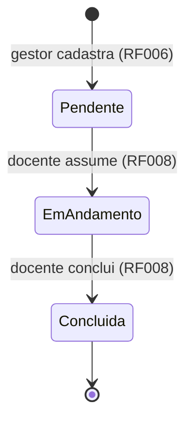
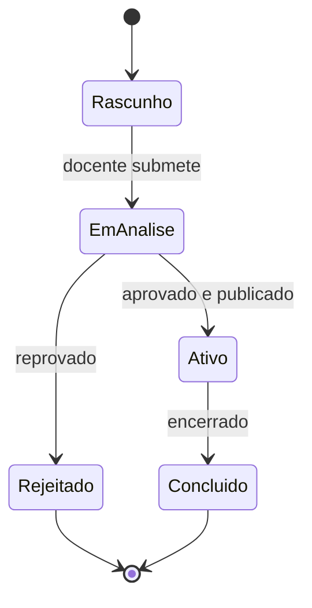

# DER — Modelo de dados do Extensopédia

> Rascunho da issue #19. Baseado nos RF001 a RF010. Tipos e colunas completos em [dicionario-de-dados.md](dicionario-de-dados.md).

## Convenções

- IDs: `bigint generated always as identity` (tabelas de domínio: `smallint`).
- Datas com hora: `timestamptz`. Datas simples: `date`.
- Dinheiro: `numeric(12,2)`.
- Status: **tabelas de domínio** (evoluem sem migration pesada).
- Nomes de tabelas e colunas em `snake_case`, sem acento.

## Diagrama entidade-relacionamento

```mermaid
erDiagram
    ESTADOS ||--o{ CIDADES : possui
    CIDADES ||--o{ ESCOLAS : localiza
    TIPOS_ESCOLA ||--o{ ESCOLAS : classifica
    DEPENDENCIAS_ADMINISTRATIVAS ||--o{ ESCOLAS : classifica

    PERFIS ||--o{ USUARIOS : define
    USUARIOS ||--o{ TOKENS_REDEFINICAO_SENHA : solicita

    ESCOLAS ||--o{ DEMANDAS : registra
    USUARIOS ||--o{ DEMANDAS : cadastra
    USUARIOS |o--o{ DEMANDAS : assume
    STATUS_DEMANDA ||--o{ DEMANDAS : situa
    PRIORIDADES ||--o{ DEMANDAS : prioriza
    AREAS_TEMATICAS ||--o{ DEMANDAS : classifica
    TIPOS_ATIVIDADE ||--o{ DEMANDAS : classifica
    DEMANDAS ||--o{ ANEXOS_DEMANDA : possui
    DEMANDAS ||--o{ MENSAGENS : troca
    DEMANDAS ||--o{ REUNIOES : agenda
    USUARIOS ||--o{ MENSAGENS : escreve
    USUARIOS ||--o{ REUNIOES : organiza

    AREAS_TEMATICAS ||--o{ SUBAREAS : possui
    AREAS_TEMATICAS ||--o{ PROJETOS : classifica
    SUBAREAS ||--o{ PROJETOS : classifica
    STATUS_PROJETO ||--o{ PROJETOS : situa
    USUARIOS ||--o{ PROJETOS : propoe
    PROJETOS ||--o{ PROJETO_COLABORADORES : tem
    USUARIOS |o--o{ PROJETO_COLABORADORES : e
    PROJETOS ||--o{ CRONOGRAMA_ATIVIDADES : planeja
    PROJETOS ||--o{ ITENS_ORCAMENTO : orca

    PROJETOS ||--o{ CANDIDATURAS : recebe
    ESCOLAS ||--o{ CANDIDATURAS : envia
    USUARIOS ||--o{ CANDIDATURAS : registra

    DEMANDAS |o--o{ FEEDBACKS : avaliada
    PROJETOS |o--o{ FEEDBACKS : avaliado
    USUARIOS ||--o{ FEEDBACKS : escreve

    USUARIOS ||--o{ NOTIFICACOES : recebe
    TIPOS_NOTIFICACAO ||--o{ NOTIFICACOES : classifica
    USUARIOS |o--o{ AUDIT_LOG : executa
    USUARIOS |o--o{ CONFIGURACOES : atualiza

    ESTADOS {
        smallint id PK
        char2 sigla UK
        varchar nome
    }
    CIDADES {
        int id PK
        smallint estado_id FK
        varchar nome
    }
    PERFIS {
        smallint id PK
        varchar codigo UK
        varchar nome
    }
    USUARIOS {
        bigint id PK
        varchar nome
        varchar email UK
        varchar senha_hash
        smallint perfil_id FK
        varchar curso
        varchar lattes_url
        boolean suspenso
        timestamptz criado_em
    }
    TOKENS_REDEFINICAO_SENHA {
        bigint id PK
        bigint usuario_id FK
        varchar token_hash UK
        timestamptz expira_em
        timestamptz usado_em
    }
    ESCOLAS {
        bigint id PK
        varchar nome
        char8 inep UK
        varchar endereco
        int cidade_id FK
        varchar url_google_maps
        smallint tipo_escola_id FK
        smallint dependencia_id FK
        int numero_alunos
        varchar site
        varchar contato_email
        varchar contato_telefone
    }
    DEMANDAS {
        bigint id PK
        bigint escola_id FK
        bigint criado_por FK
        varchar titulo
        text descricao
        smallint area_id FK
        smallint tipo_atividade_id FK
        text recursos
        varchar publico_alvo
        int quantidade_publico
        smallint prioridade_id FK
        date data_limite
        smallint status_id FK
        bigint assumida_por FK
        timestamptz assumida_em
        timestamptz concluida_em
    }
    ANEXOS_DEMANDA {
        bigint id PK
        bigint demanda_id FK
        varchar nome_arquivo
        varchar tipo_mime
        bigint tamanho_bytes
        varchar caminho
    }
    PROJETOS {
        bigint id PK
        bigint proponente_id FK
        varchar titulo
        text resumo
        int carga_horaria
        int vagas
        boolean possui_vinculo_curricular
        varchar disciplina
        smallint area_id FK
        smallint subarea_id FK
        text justificativa
        text objetivos
        text metodologia
        text recursos
        date data_inicio
        date data_fim
        smallint status_id FK
        boolean destaque
        timestamptz publicado_em
    }
    PROJETO_COLABORADORES {
        bigint id PK
        bigint projeto_id FK
        bigint usuario_id FK
        varchar nome
        varchar email
    }
    CRONOGRAMA_ATIVIDADES {
        bigint id PK
        bigint projeto_id FK
        varchar descricao
        date data_inicio
        date data_fim
    }
    ITENS_ORCAMENTO {
        bigint id PK
        bigint projeto_id FK
        varchar descricao
        int quantidade
        numeric valor_unitario
        numeric valor_total
        varchar finalidade
        varchar fonte
    }
    CANDIDATURAS {
        bigint id PK
        bigint projeto_id FK
        bigint escola_id FK
        bigint criado_por FK
        timestamptz criado_em
    }
    MENSAGENS {
        bigint id PK
        bigint demanda_id FK
        bigint autor_id FK
        text conteudo
        timestamptz criado_em
    }
    REUNIOES {
        bigint id PK
        bigint demanda_id FK
        bigint organizador_id FK
        timestamptz inicio_em
        timestamptz fim_em
        varchar local_ou_link
    }
    FEEDBACKS {
        bigint id PK
        bigint demanda_id FK
        bigint projeto_id FK
        bigint autor_id FK
        smallint nota
        text comentario
    }
    NOTIFICACOES {
        bigint id PK
        bigint usuario_id FK
        smallint tipo_id FK
        varchar titulo
        text mensagem
        bigint demanda_id FK
        bigint projeto_id FK
        timestamptz lida_em
    }
    CONFIGURACOES {
        varchar chave PK
        text valor
        bigint atualizado_por FK
        timestamptz atualizado_em
    }
    AUDIT_LOG {
        bigint id PK
        bigint usuario_id FK
        varchar acao
        varchar entidade
        bigint entidade_id
        jsonb dados_anteriores
        jsonb dados_novos
        timestamptz criado_em
    }
```

As tabelas de domínio restantes (`status_demanda`, `status_projeto`, `prioridades`, `areas_tematicas`, `subareas`, `tipos_atividade`, `tipos_escola`, `dependencias_administrativas`, `tipos_notificacao`) seguem o mesmo formato: `id`, `codigo`, `nome`, `ativo`. Detalhes no dicionário.

## Máquinas de estado

### Demanda (RF006, RF008)

### Projeto (RF009)

## Regras de integridade

| Regra | Onde | Como |
|---|---|---|
| INEP único de 8 dígitos | `escolas.inep` | `UNIQUE` + `CHECK (inep ~ '^[0-9]{8}$')` |
| Fim não pode preceder o início | `projetos`, `cronograma_atividades` | `CHECK (data_fim >= data_inicio)` |
| Valores não negativos | `itens_orcamento`, `escolas.numero_alunos`, `projetos.vagas` | `CHECK (... >= 0)` |
| Candidatura única por escola e projeto | `candidaturas` | `UNIQUE (escola_id, projeto_id)` |
| E-mail único | `usuarios.email` | `UNIQUE` (índice em `lower(email)`) |
| Disciplina obrigatória só com vínculo curricular | `projetos` | `CHECK (NOT possui_vinculo_curricular OR disciplina IS NOT NULL)` |
| Total do item calculado | `itens_orcamento.valor_total` | coluna gerada: `quantidade * valor_unitario` |
| Feedback de uma demanda **ou** de um projeto | `feedbacks` | `CHECK (num_nonnulls(demanda_id, projeto_id) = 1)` |

## Decisões em aberto (levar para a equipe e o orientador)

1. **Status do projeto:** o RF009 fala em "Submetida/Em Análise" e "Aguardando Aprovação Institucional", mas a issue lista só Rascunho → Em análise → Ativo → Concluído/Rejeitado. Existe um estado extra de aprovação institucional?
2. **Quem aprova o projeto** (Em análise → Ativo): administrador ou outro papel?
3. **Valores das listas de domínio** que os RFs não definem: prioridades, tipos de escola, tipos de atividade, áreas e subáreas.
4. **Feedbacks** não aparecem nos RFs; confirmar quem avalia o quê (escola avalia demanda atendida? projeto?).
5. **Tipo do ID:** `bigint identity` (proposto) ou `uuid`.
6. **Anexos:** guardar o arquivo em disco/volume do Docker e só o caminho no banco (proposto).
7. **Localização da escola:** o RF005 pede "localização Google Maps". Guardar só o link (proposto) ou latitude/longitude (necessário para filtro por proximidade, ligado à decisão PostGIS x Haversine do ADR).
